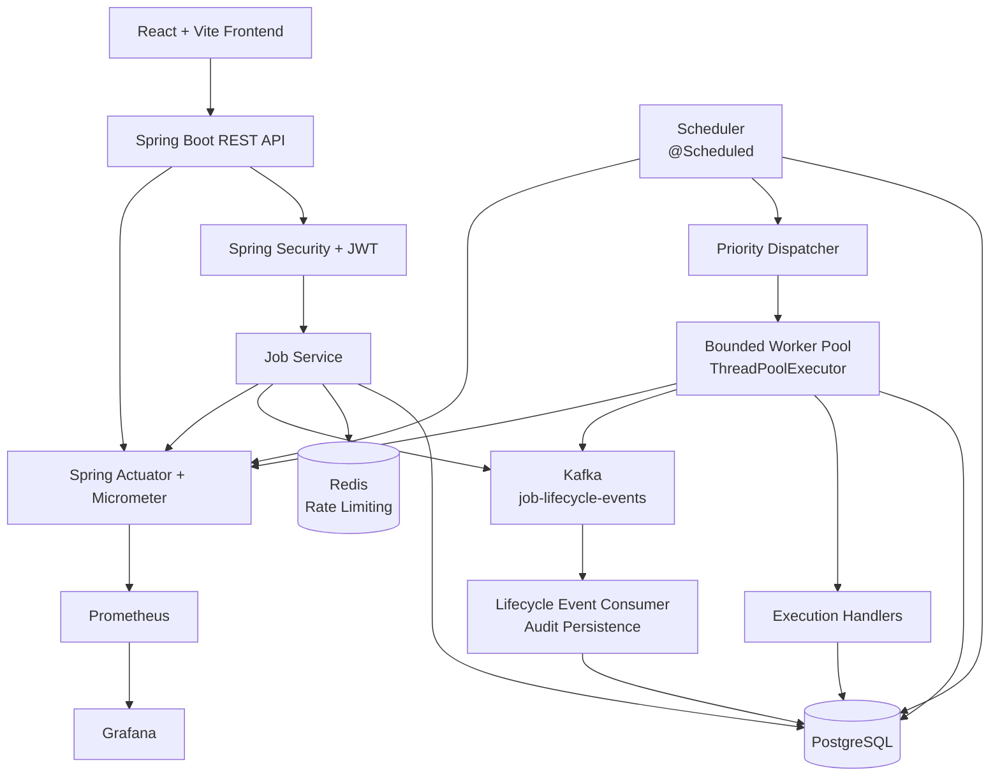
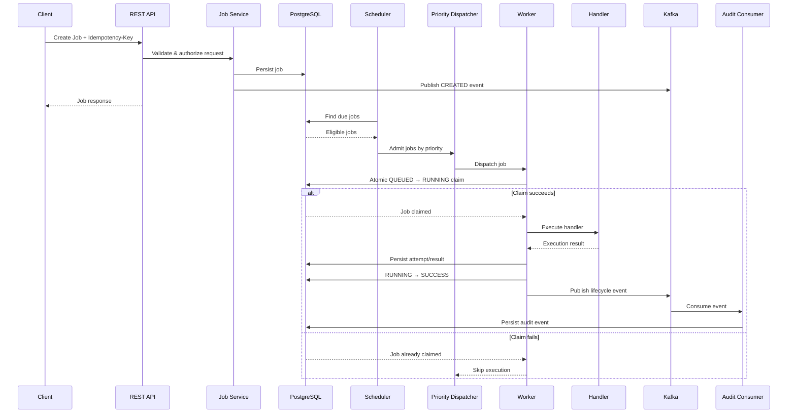
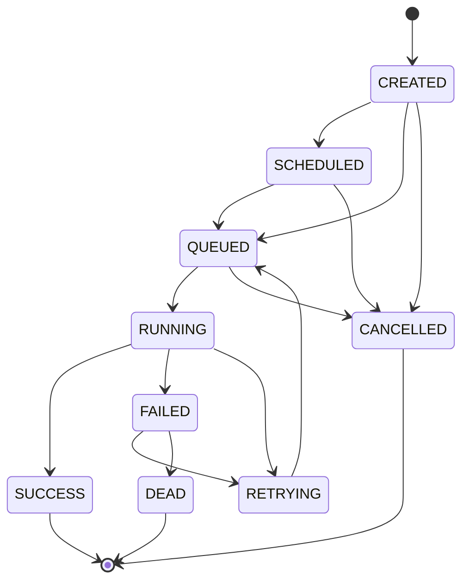
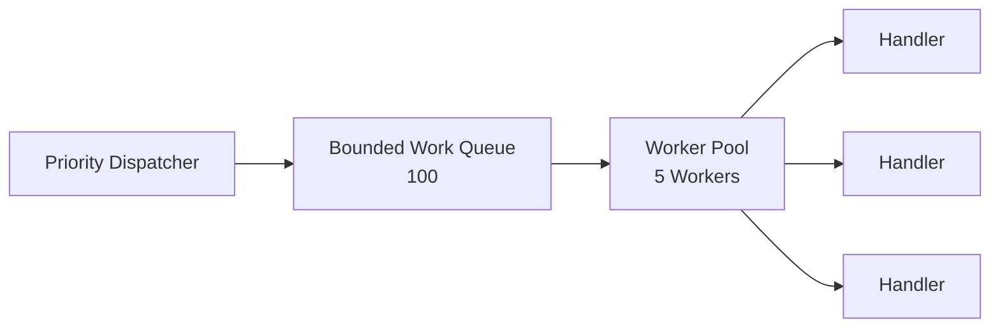
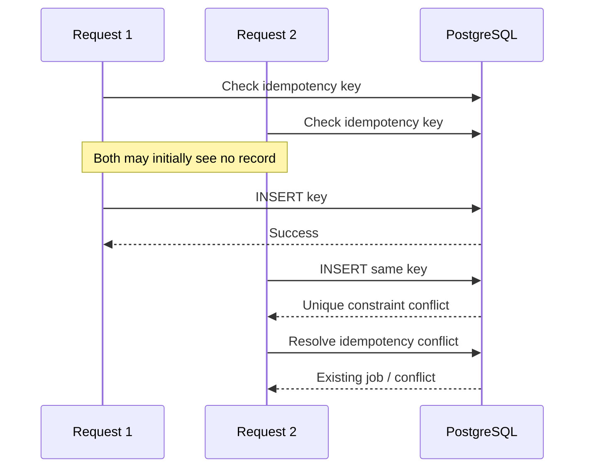
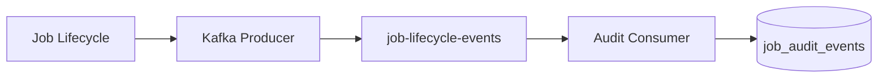
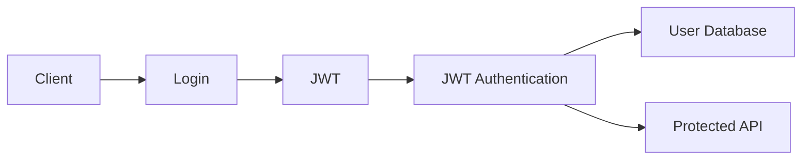
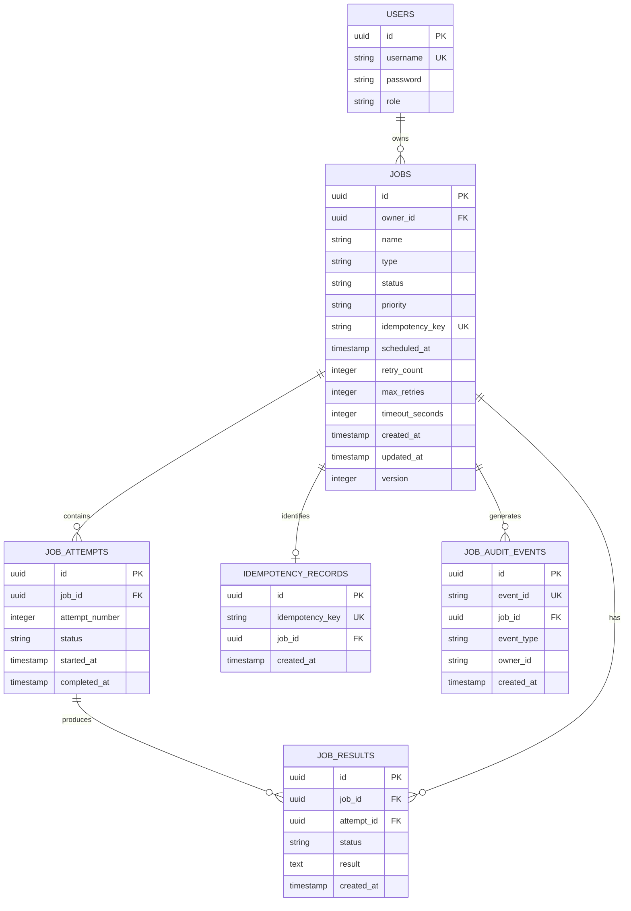
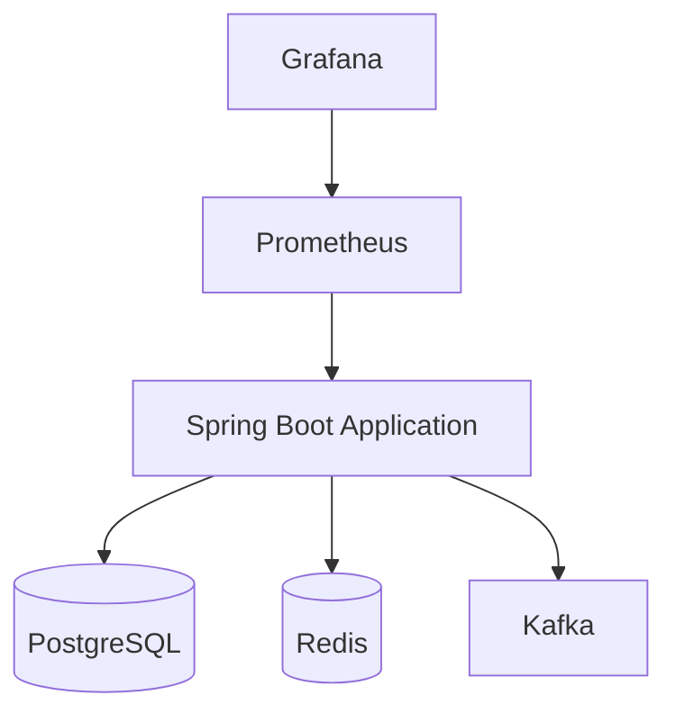
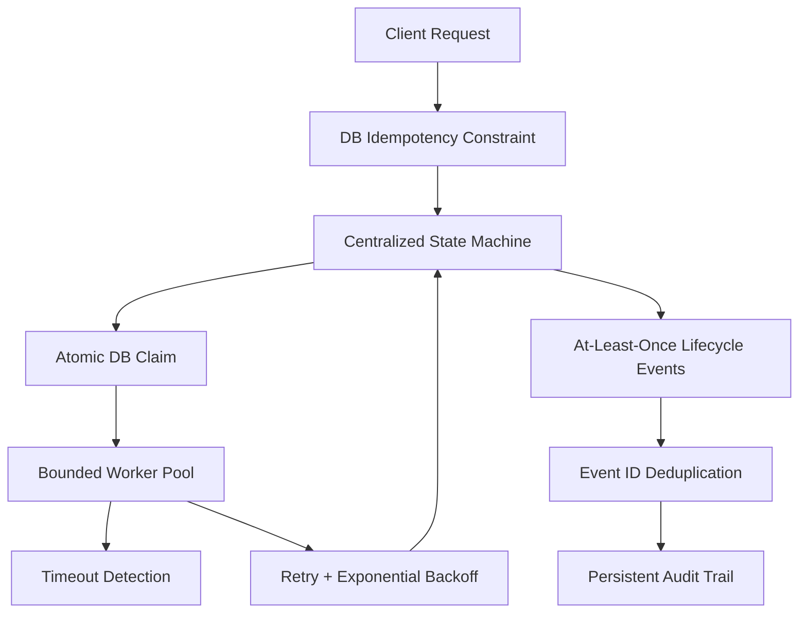

# Distributed Job Scheduling & Task Execution Platform

A backend-focused job scheduling and task execution platform built with Spring Boot, PostgreSQL, Redis, Kafka, and a bounded worker pool.

The system accepts jobs through a secured REST API, schedules and prioritizes them, dispatches work through a bounded execution pool, persists execution state and results, retries failed jobs with exponential backoff, prevents duplicate job creation through database-backed idempotency, publishes lifecycle events through Kafka, and exposes operational metrics through Prometheus and Grafana.

The project focuses on the engineering problems behind reliable job execution: **state management, concurrency control, scheduling, retry semantics, idempotency, rate limiting, event-driven auditing, security, and observability.**

---

## Architecture



### Architecture Principles

- **PostgreSQL is the source of truth** for job state, attempts, results, users, idempotency records, and audit events.
- **The scheduler admits jobs; it does not execute them.**
- **Workers claim jobs atomically through the database** before execution.
- **The worker pool is bounded** to prevent unlimited thread creation.
- **Kafka is used for lifecycle events and audit propagation, not as the primary job queue.**
- **Redis is used for rate limiting, not durable job state.**
- **Job state transitions are centralized** to prevent invalid lifecycle changes.
- **At-least-once execution semantics** are used rather than claiming exactly-once execution.
- Database transactions around state changes are intentionally short; long-running task execution does not hold a database transaction open.

---

## End-to-End Execution Flow

A typical job moves through the following pipeline:



---

## Job Lifecycle

The platform uses a centralized state machine to control job lifecycle transitions.



`DEAD` represents a job that has exhausted its automatic retry path. Controlled recovery can explicitly re-admit a dead job through the recovery validation path.

This keeps lifecycle rules in one place instead of allowing individual controllers or services to perform arbitrary status changes.

---

# Core Engineering

## 1. Scheduling and Priority Dispatch

The scheduler periodically scans PostgreSQL for jobs that are eligible for execution.

The scheduler:

1. Finds due `CREATED`, `SCHEDULED`, and retryable `RETRYING` jobs.
2. Selects jobs in batches.
3. Admits them to the in-memory dispatch layer.
4. Orders work according to job priority.
5. Leaves actual execution to the worker pool.

The scheduler runs with a default fixed delay of approximately **5 seconds** and processes jobs in batches.

```text
PostgreSQL
    |
    v
Scheduler
    |
    v
Priority Dispatcher
    |
    v
Bounded Worker Pool
    |
    v
Execution Handler
```

Supported priorities:

```text
HIGH
MEDIUM
LOW
```

Priority ordering is applied at dispatch time so higher-priority work is selected before lower-priority work when competing jobs are waiting.

The database remains authoritative for job state; the in-memory dispatch layer is not used as durable storage.

---

## 2. Concurrency-Safe Job Claiming

One of the key problems in a job execution system is preventing multiple workers from executing the same queued job concurrently.

The platform does not rely only on in-memory synchronization.

Instead, workers perform an atomic conditional database update conceptually equivalent to:

```sql
UPDATE jobs
SET status = 'RUNNING',
    ...
WHERE id = ?
  AND status = 'QUEUED';
```

The worker checks the affected row count.

```text
1 row updated
    → worker successfully claimed the job
    → execute task

0 rows updated
    → another worker already claimed it
    → do not execute
```

This creates a database-backed compare-and-set boundary.

A concurrency test with multiple competing worker threads verifies that only one worker can successfully claim the same queued job.

```text
10 concurrent workers
        |
        v
   Same QUEUED job
        |
        v
 Atomic DB claim
        |
   +----+----+
   |         |
1 winner   9 rejected
   |
   v
Execution
```

This provides **at-least-once execution semantics with atomic claiming**, rather than claiming exactly-once execution.

---

## 3. Bounded Worker Pool

Task execution is performed using a bounded `ThreadPoolExecutor`.

The configured executor uses:

```text
Core workers       : 5
Maximum workers    : 5
Queue capacity     : 100
Rejected execution : CallerRunsPolicy
```

The bounded design prevents the application from creating an unlimited number of worker threads when job volume increases.



The worker lifecycle is deliberately separated from the scheduler:

```text
Scheduler
   |
   | admission
   v
Priority Dispatcher
   |
   | dispatch
   v
Worker Pool
   |
   | claim
   v
PostgreSQL
   |
   | execution
   v
Handler
```

This prevents the scheduler itself from becoming the execution bottleneck.

---

## 4. Retry and Exponential Backoff

Failed jobs can enter the retry lifecycle instead of immediately becoming terminal.

The retry flow is:

```text
RUNNING
   |
   v
FAILED
   |
   v
RETRYING
   |
   | scheduledAt = now + backoff
   v
Scheduler
   |
   v
QUEUED
   |
   v
RUNNING
```

The retry delay follows exponential backoff:

```text
base delay = 1 second

retry 1 → 1s
retry 2 → 2s
retry 3 → 4s
retry 4 → 8s
retry 5 → 16s
...
maximum → 30s
```

Conceptually:

```text
delay = min(baseDelay × 2^retryCount, maxDelay)
```

The retry mechanism does **not** keep a worker thread sleeping during the backoff period.

Instead, the next execution time is persisted and the scheduler picks the job up when it becomes eligible.

This allows workers to return to the pool rather than being occupied by sleeping retry tasks.

---

## 5. Timeout Handling

Jobs can specify an execution timeout.

The execution layer waits for the handler result with a bounded timeout:

```text
Worker
   |
   v
Handler Future
   |
   +---- completes before timeout → SUCCESS
   |
   +---- timeout → TIMED_OUT attempt
                       |
                       v
                 retry / DEAD
```

Timeout handling records the timeout attempt and uses the same atomic state-update boundary that protects normal completion/failure races.

Timeout interruption is **cooperative**. The platform requests interruption of the underlying task, but arbitrary code that ignores interruption cannot be forcibly terminated by the JVM.

---

## 6. Database-Backed Idempotency

The create-job API supports an `Idempotency-Key`.

The key is backed by database uniqueness rather than relying only on application memory.

This protects against duplicate requests such as:

```text
Client
  |
  +---- POST /jobs
  |       Idempotency-Key: abc123
  |
  +---- POST /jobs
          Idempotency-Key: abc123
```

The database uniqueness boundary ensures that concurrent requests cannot independently create duplicate jobs for the same idempotency key.

The implementation also handles the race where multiple requests pass an initial lookup simultaneously and one request wins the database insert.



Concurrent tests verify the behavior under high contention.

Importantly:

> **Request idempotency is not execution idempotency.**

An idempotency key prevents duplicate job creation. It does not magically make arbitrary task execution exactly-once.

---

## 7. Kafka Lifecycle Events

Kafka is used as an asynchronous lifecycle event bus.

The primary topic is:

```text
job-lifecycle-events
```

Lifecycle events include events such as:

```text
JOB_CREATED
JOB_SCHEDULED
JOB_QUEUED
JOB_STARTED
JOB_COMPLETED
JOB_FAILED
JOB_RETRIED
JOB_DEAD
```

The event flow is:



Kafka is intentionally **not** treated as the source of truth for job execution.

PostgreSQL owns the authoritative job state.

Kafka provides asynchronous propagation of lifecycle information to consumers such as the audit pipeline.

### Event Deduplication

Events contain a unique `eventId`.

The audit persistence layer uses a database uniqueness boundary so duplicate delivery does not create duplicate audit records.

Conceptually:

```text
Kafka delivery
      |
      v
eventId
      |
      v
unique DB constraint
      |
      +---- new event → persist
      |
      +---- duplicate → ignore
```

This follows an at-least-once event delivery model while making the consumer tolerant of duplicate delivery.

---

## 8. Redis Rate Limiting

Redis is used specifically for API rate limiting.

It is not used to store durable job state.

The limiter uses an atomic Lua-based sliding-window mechanism to coordinate request counts.

Default configuration:

```text
100 requests / minute / user
```

When the limit is exceeded, the API responds with:

```text
HTTP 429 Too Many Requests
```

The response includes rate-limit metadata such as:

```text
Retry-After
X-RateLimit-*
```

The Redis operation is atomic so concurrent requests cannot independently bypass the same rate-limit boundary.

Redis availability is treated as a non-critical dependency for this control: the application is configured to fail open rather than making the entire job API unavailable when rate limiting infrastructure is unavailable.

---

# Security

The API uses Spring Security with JWT-based authentication.



### Authentication

- JWT-based authentication
- HS256 signing
- BCrypt password hashing
- 24-hour token expiry
- Base64-encoded secret with at least a 256-bit key
- Invalid, expired, or malformed tokens result in `401 Unauthorized`

### Authorization

The application distinguishes:

```text
USER
ADMIN
```

Users can operate on their own jobs, while administrative operations are protected separately.

The registration endpoint does not allow clients to self-register as administrators. Public registration always creates a `USER` role.

### Ownership Enforcement

Job access is ownership-aware.

A user cannot use another user's job identifier to access:

- job details
- attempts
- results
- cancellation
- retry operations

Administrative job views use explicit administrative authorization.

### API Validation

Request validation also constrains resource usage, including:

```text
Payload size        ≤ 10 KB
Retry count         1–10
Timeout             1–3600 seconds
```

The application does not execute arbitrary operating-system commands through `ProcessBuilder`, `Runtime.exec`, or equivalent command execution APIs.

---

# Database Design

PostgreSQL is the authoritative persistence layer.



### Persistence Responsibilities

| Table | Responsibility |
|---|---|
| `users` | Authentication and roles |
| `jobs` | Authoritative job definition and lifecycle state |
| `job_attempts` | Individual execution attempts |
| `job_results` | Results associated with attempts |
| `idempotency_records` | Request idempotency boundary |
| `job_audit_events` | Kafka lifecycle event audit trail |

The `jobs` table contains indexes supporting common scheduler, ownership, priority, and idempotency access patterns.

Optimistic versioning is also used on the job entity, while critical execution transitions use explicit conditional updates.

---

# Observability

The application exposes operational metrics through:

```text
Spring Actuator
      |
      v
Micrometer
      |
      v
Prometheus
      |
      v
Grafana
```

Important metrics include:

```text
jobs_created_total
jobs_completed_total
jobs_failed_total
jobs_retried_total
jobs_dead_total
rate_limit_rejections_total

jobs_execution_duration_seconds
workers_active
jobs_queue_depth
```

Execution latency can be observed through percentile measurements such as:

```text
p50
p95
p99
```

A Grafana dashboard provides a consolidated view of:

- job throughput
- execution latency
- failures
- retries
- dead jobs
- worker utilization
- queue depth
- rate-limit rejections

The metrics pipeline was also verified against the actual Dockerized infrastructure rather than being limited to mocked tests.

---

# API

## Authentication

```text
POST /api/auth/register
POST /api/auth/login
GET  /api/auth/me
```

## Jobs

```text
POST   /api/jobs
GET    /api/jobs
GET    /api/jobs/{id}
POST   /api/jobs/{id}/cancel
POST   /api/jobs/{id}/retry
GET    /api/jobs/{id}/attempts
GET    /api/jobs/{id}/result
```

## Administrative Operations

```text
POST /api/jobs/{id}/recover
GET  /api/admin/jobs
```

Administrative endpoints require the `ADMIN` role.

---

## Creating a Job

Example request:

```bash
curl -X POST http://localhost:8080/api/jobs \
  -H "Authorization: Bearer <JWT>" \
  -H "Content-Type: application/json" \
  -H "Idempotency-Key: demo-job-001" \
  -d '{
    "name": "Example Job",
    "type": "DEMO_TASK",
    "priority": "HIGH",
    "scheduledAt": null,
    "maxRetries": 3,
    "timeoutSeconds": 30
  }'
```

The idempotency key can be reused safely for retries of the same logical request.

---

# Supported Job Types

The project contains deterministic/simulated handlers for demonstrating the scheduling and execution infrastructure.

```text
DEMO_TASK
REPORT
DATA_CLEANUP
EMAIL
FAILING
```

These handlers are intentionally simulated.

The project demonstrates the **execution infrastructure and reliability mechanisms**, rather than integrating with real external email providers, reporting engines, payment systems, or arbitrary operating-system processes.

---

# Frontend

The project includes a React frontend built with:

```text
React
Vite
Tailwind CSS
```

The frontend provides the core interaction flow for:

- registration
- login
- authenticated job listing
- job creation
- job details
- cancellation
- retry
- administrative recovery

JWT authentication is handled on the client side, with authentication failures clearing the stored token.

The development frontend communicates with the Spring Boot backend through the Vite proxy.

The UI also surfaces backend errors such as:

```text
401 Unauthorized
403 Forbidden
404 Not Found
409 Conflict
429 Too Many Requests
```

Administrative recovery controls are shown only for administrative users, while the backend remains the authoritative authorization boundary.

---

# Dockerized Infrastructure

The backend infrastructure can be run through Docker Compose.

The development stack contains six containers:

```text
Spring Boot Application
PostgreSQL
Redis
Kafka
Prometheus
Grafana
```



The Compose configuration includes health checks and startup dependencies so infrastructure services can become ready before dependent services begin normal operation.

Persistent volumes are used for infrastructure data.

Kafka uses its internal listener for container-to-container communication.

---

# Technology Stack

| Layer | Technology |
|---|---|
| Language | Java 17 |
| Backend | Spring Boot 3.2.5 |
| Persistence | Spring Data JPA / Hibernate |
| Database | PostgreSQL 16 |
| Cache / Rate Limiting | Redis 7 |
| Event Streaming | Apache Kafka 3.6 |
| Security | Spring Security + JWT |
| Authentication Library | JJWT 0.12.5 |
| Scheduling | Spring `@Scheduled` |
| Concurrency | `ThreadPoolExecutor` |
| Metrics | Spring Actuator + Micrometer |
| Monitoring | Prometheus + Grafana |
| Frontend | React 18 |
| Frontend Tooling | Vite |
| Styling | Tailwind CSS |
| Containerization | Docker + Docker Compose |
| Testing | JUnit 5 + Mockito |
| Build | Maven |

---

# Testing

The test suite covers the major correctness boundaries of the platform.

```text
128 / 128 tests passing
```

Coverage includes:

| Area | What is tested |
|---|---|
| State machine | Valid and invalid lifecycle transitions |
| Idempotency | Concurrent duplicate requests |
| Job service | Business rules and lifecycle behavior |
| Concurrency | Atomic worker claiming and execution races |
| Security | Authentication, authorization, ownership and roles |
| Kafka consumer | Event persistence and duplicate handling |
| Retry logic | Backoff, retries and terminal failure |
| Handler registry | Handler resolution and registration |

Concurrency tests specifically exercise multiple threads competing for the same resources rather than testing only single-threaded happy paths.

---

# Runtime Verification

The complete infrastructure was also exercised against the real Dockerized environment.

Verified runtime components include:

```text
PostgreSQL
Redis
Kafka
Prometheus
Grafana
Spring Boot Application
```

Runtime verification includes:

```text
Application health
Database connectivity
Redis rate limiting
Kafka publishing and consumption
Audit-event persistence
Prometheus scraping
Grafana metrics
Authentication
Job creation
Job execution
Priority dispatch
Retry flow
Dead-job recovery
Idempotency under concurrency
Ownership enforcement
Rate-limit rejection
Frontend/backend integration
```

The end-to-end runtime verification completed with:

```text
15 / 15 checks passed
```

The automated backend suite completed with:

```text
128 / 128 tests passed
BUILD SUCCESS
```

---

# Engineering Decisions

## PostgreSQL as the Source of Truth

Job state is persisted in PostgreSQL rather than relying on in-memory state.

This allows the application to reason about ownership, lifecycle, retries, attempts, and idempotency using durable data.

---

## Database Claim Instead of Application-Level Locking

Worker coordination uses an atomic conditional database update.

This avoids depending solely on JVM-level locks and makes the claim boundary explicit at the persistence layer.

---

## Scheduler Separate from Execution

The scheduler only discovers and admits work.

Workers are responsible for claiming and executing it.

This separation keeps scheduling logic independent from task execution.

---

## Retry Through Scheduling

Workers do not sleep for the entire retry delay.

Instead, the next eligible execution time is persisted and the scheduler later re-admits the job.

This prevents retry delays from consuming worker capacity.

---

## Kafka as an Event Bus

Kafka carries lifecycle events rather than replacing the authoritative job database.

This keeps job execution correctness independent of Kafka availability while still allowing asynchronous consumers and audit pipelines.

---

## Redis Only for Ephemeral Controls

Redis is intentionally limited to rate limiting.

Durable job state is never stored only in Redis.

---

## At-Least-Once Rather Than Exactly-Once

The system explicitly uses at-least-once execution semantics.

Atomic claiming, idempotency, and event deduplication reduce duplicate effects, but the platform does not claim that arbitrary task execution is exactly once.

---

## Short Transaction Boundaries

Long-running handler execution does not keep a database transaction open.

Atomic operations such as:

```text
QUEUED → RUNNING
RUNNING → SUCCESS
RUNNING → FAILED
```

use short database transactions around the state mutation.

This prevents a slow handler or long timeout from unnecessarily holding a PostgreSQL connection for the entire execution duration.

---

# Reliability Model

The main reliability boundaries can be summarized as:



Each mechanism addresses a different failure mode:

```text
Idempotency
    → duplicate API requests

State machine
    → invalid lifecycle transitions

Atomic claim
    → competing workers

Bounded pool
    → uncontrolled thread growth

Retry/backoff
    → transient execution failures

Timeout
    → long-running executions

Kafka deduplication
    → duplicate event delivery

Persistent audit
    → lifecycle traceability
```

---

# Project Structure

```text
Distributed-Job-Scheduling-and-Task-Execution/
│
├── src/
│   ├── main/
│   │   ├── java/
│   │   │   └── ...
│   │   └── resources/
│   │       └── ...
│   │
│   └── test/
│       └── java/
│           └── ...
│
├── frontend/
│   ├── src/
│   ├── public/
│   ├── package.json
│   └── vite.config.*
│
├── grafana/
│   └── ...
│
├── prometheus/
│   └── ...
│
├── docker-compose.yml
├── Dockerfile
├── pom.xml
├── README.md
└── .gitignore
```

The backend is organized around the major application responsibilities rather than splitting the platform into unnecessary microservices.

---

# Local Development

## Prerequisites

Install:

```text
Java 17
Maven
Docker
Docker Compose
Node.js
npm
```

---

## Start Infrastructure

From the project root, create the local environment file from the template
(placeholder values only — `.env` is git-ignored and must never be committed):

```bash
cp .env.example .env
```

Open `.env` and replace every placeholder with your own development values
(see the comments inside the file), then start the stack:

```bash
docker compose up -d
```

Check container health:

```bash
docker compose ps
```

The Spring Boot application exposes:

```text
http://localhost:8080
```

Health endpoint:

```text
http://localhost:8080/actuator/health
```

Prometheus:

```text
http://localhost:9090
```

Grafana:

```text
http://localhost:3001
```

---

## Build Backend

```bash
mvn clean test
```

Create the application package:

```bash
mvn package -DskipTests
```

---

## Run Frontend

```bash
cd frontend
npm install
npm run dev
```

The Vite development server normally starts on:

```text
http://localhost:5173
```

The frontend uses the configured Vite proxy to communicate with the Spring Boot backend.

---

# Configuration

Environment-specific values can be overridden instead of hard-coding deployment secrets.

Important configuration areas include:

```text
Database connection
Redis connection
Kafka bootstrap servers
JWT secret
JWT expiration
Rate-limit configuration
Scheduler interval
Worker pool configuration
Job execution limits
```

For example, the application supports configuration for rate limiting and execution behavior through Spring configuration properties/environment overrides.

Secured values (database password, JWT secret, admin/demo passwords) are not
hard-coded. They are read from environment variables and supplied to the
Docker Compose stack through a local `.env` file (see `.env.example` for the
expected variables and placeholders). Non-sensitive defaults exist for local
execution (connection URLs, ports, usernames), but deployment environments
must provide their own credentials and secrets — never reuse the placeholder
values from `.env.example` outside local development.

---

# Scope

This project intentionally focuses on the scheduling and execution infrastructure.

It is designed to demonstrate:

```text
Job scheduling
Priority dispatch
Concurrent worker coordination
Retry handling
Timeout detection
Idempotent request handling
Lifecycle events
Audit persistence
Rate limiting
Authentication / authorization
Operational observability
```

It does not attempt to become a general-purpose operating-system process scheduler or a full distributed workflow engine.

Task handlers are simulated so that the platform can focus on execution orchestration and reliability mechanics without introducing uncontrolled external side effects.

---

# Future Improvements

Potential extensions include:

- Durable distributed scheduling with scheduler leases or database-backed job claiming at admission time
- Persistent distributed priority queues
- Horizontal worker instances with coordinated work distribution
- Stronger task cancellation and process isolation
- Real external task integrations
- Kafka authentication and TLS
- Redis authentication and TLS
- Production secret management
- More advanced scheduling expressions
- Dead-letter/event replay workflows
- Worker heartbeats and lease expiration
- Per-tenant quotas and resource limits
- Containerized isolated task execution
- Production deployment and autoscaling

---

# Project Highlights

This project demonstrates backend engineering beyond conventional CRUD APIs:

- Database-backed state machines for job lifecycle management
- Atomic compare-and-set job claiming under concurrent workers
- Bounded thread-pool execution with backpressure
- Priority-based task dispatch
- Scheduler-driven exponential retry and backoff
- Cooperative execution timeout handling
- Race-safe database-backed request idempotency
- At-least-once Kafka lifecycle events
- Idempotent Kafka audit consumption
- Atomic Redis sliding-window rate limiting
- JWT authentication and role-based authorization
- Resource ownership enforcement
- Prometheus/Grafana operational metrics
- Dockerized PostgreSQL, Redis, Kafka, Prometheus and Grafana infrastructure
- Automated concurrency, security, lifecycle and integration testing

---

# Author

**Devang Thummar**

Computer Engineering Student

- GitHub: https://github.com/devangthummar
- LinkedIn: www.linkedin.com/in/devang-thummar-a98796397
